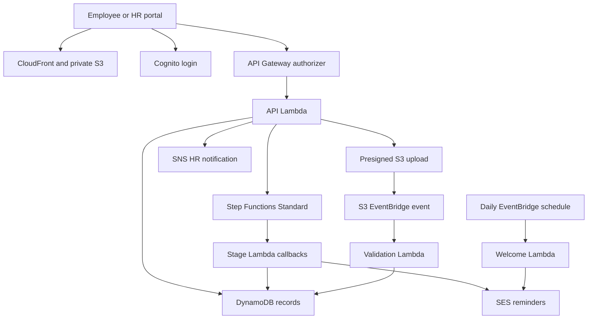
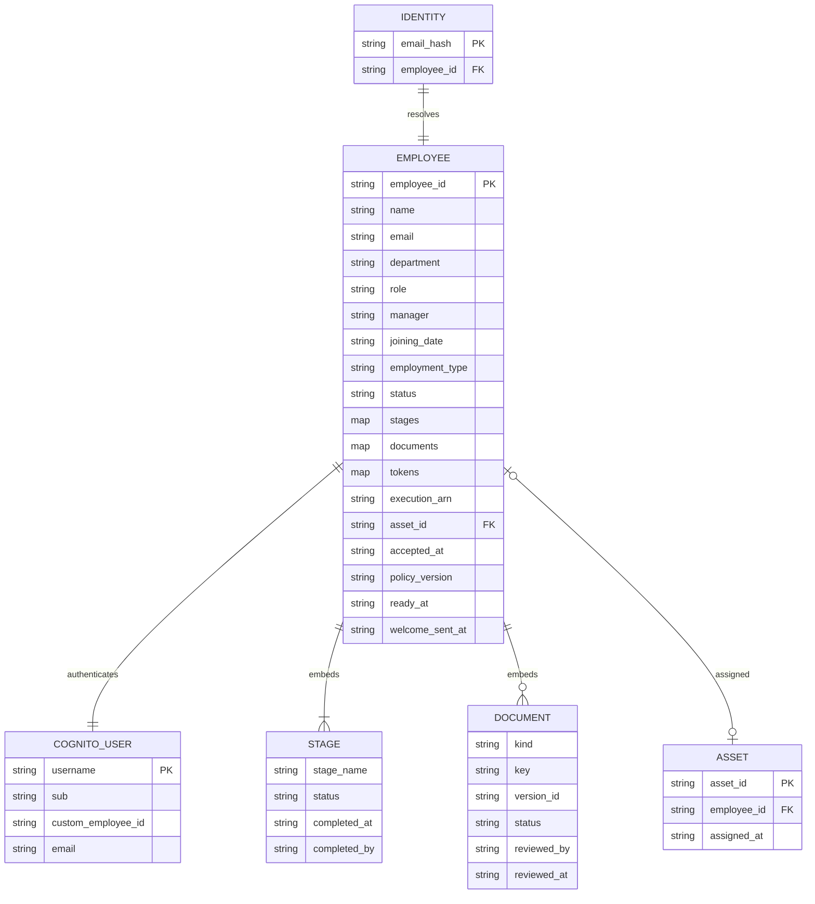

# Architecture and schema

## System design

CloudFront delivers the static app over HTTPS. Documents live in a different private bucket. The API uses a Cognito authorizer plus server-side ownership/group checks. Employee UUIDs identify canonical records; an identity record is reserved before Cognito provisioning so a retried invitation can resume with the same employee ID.

The API trusts only authorizer claims, never a frontend-supplied HR flag. The new hire's Cognito username equals `employee_id`. HR administrators belong to the `HRAdmin` group. Callback tokens are held in DynamoDB but omitted from API responses.

## Logical ER diagram

DynamoDB has no enforced foreign keys. The relationships below are maintained by application logic. `STAGE` and `DOCUMENT` are embedded maps within each employee item; they are not separate DynamoDB tables.

`schema.svg` is the static export for inclusion in presentations.

## Physical storage

| Store | Primary key | Access pattern |
|---|---|---|
| Employees | `employee_id` (String UUID) | Consistent point-read by identity; 50-item paginated HR scan |
| Identities | `email_hash` (SHA-256 of trimmed lower-case email) | Conditional reservation; invitation retry recovery |
| Assets | `asset_id` (String) | Atomic assignment with employee item in DynamoDB transaction |
| S3 documents | `employee_id/kind/upload_uuid` plus VersionId | Direct bounded upload; private version-specific HR review |

No GSIs are necessary for the initial 50-onboarding-events/month scale. DynamoDB on-demand billing, server-side encryption, and point-in-time recovery are enabled. Email hashes avoid using plain email as keys, but are not anonymization.

Employee lifecycle: `invited` → `onboarding` → `ready`.
Stage lifecycle: `pending` → `in-progress` → `complete`.
Document lifecycle: `awaiting_upload` → `received` → `verified` or `rejected`.

An upload is not a verification. The event handler checks its exact S3 version, size, MIME type, and file signature. HR makes the content-verification decision. Invalid bytes are deleted by version. Overwritten or delayed object events cannot overwrite the state of a newer upload request.

## API contract

All endpoints require a Cognito **ID token** in the `Authorization` header. Do not substitute an access token without changing authorizer configuration. API Gateway REST Cognito authorizers validate the token; client-side JWT decoding only selects the visual view.

| Method | Path | Who | Body / result |
|---|---|---|---|
| POST | `/employees` | HR | Profile attributes → employee record and Cognito invitation |
| GET | `/employees?cursor=UUID` | HR | `{items, cursor}`; use returned cursor until absent |
| GET | `/me` | Employee | Employee, stages, document states, progress |
| GET | `/employees/{id}` | Self or HR | Same progress representation |
| POST | `/employees/{id}/accept` | Self | `{accepted:true}` |
| POST | `/employees/{id}/upload` | Self or HR | `{kind, content_type}` → presigned POST `{url,fields}` |
| POST | `/employees/{id}/review-link` | HR | `{kind}` → 120-second version-specific download URL |
| POST | `/employees/{id}/verify` | HR | `{kind, decision:"verified" or "rejected"}` |
| POST | `/employees/{id}/it` | HR | `{asset_id}` → reserves asset and enables group access |
| POST | `/employees/{id}/policy` | Self | `{accepted:true, version:"2026-01"}` |
| POST | `/employees/{id}/manager` | HR | `{confirmed:true}` |

Required profile fields: `name`, `email`, `department`, `role`, `manager`, `joining_date` (YYYY-MM-DD), `employment_type` (`full_time`, `part_time`, `contract`, `intern`). Documents: `id_proof`, `degree_certificate`, `signed_offer`.

## Workflow and reminders

1. Offer acceptance persists a timestamp and starts an execution named with the employee UUID.
2. A callback Lambda stores the private task token, marks the stage in progress, and emails the responsible person.
3. Human completion updates DynamoDB first, then calls `SendTaskSuccess`. If completion precedes token registration, the registration handler sees the completed status and resumes itself.
4. At 86,400 seconds, an incomplete task times out and the catch branch re-enters the same stage with a fresh token, sending a reminder. Use a 60-second parameter only for the demo.
5. After the four stages, the ready handler records readiness and sends completion communication.
6. A daily job sends joining-day welcome email to ready employees. Failures/timeouts/aborts are routed to SNS.

Standard workflows support callback waits; Express workflows do not support this integration pattern. See [AWS callback integration documentation](https://docs.aws.amazon.com/step-functions/latest/dg/connect-to-resource.html). The template uses Cognito's SES developer email configuration for invitations; see [AWS Cognito email settings](https://docs.aws.amazon.com/cognito/latest/developerguide/user-pool-email.html).

The exported ASL retains CloudFormation references and is intended for the SAM template. Resolve those references before attempting standalone console import.
